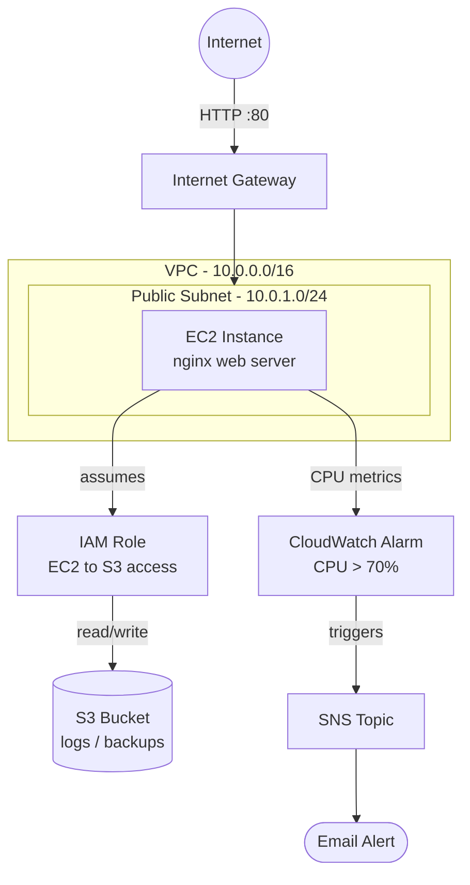

# AWS Web App Deployment (Terraform)

A small, fully working AWS project built with **Infrastructure as Code (Terraform)** that
provisions a web server from scratch — networking, compute, storage, IAM, and monitoring —
without ever clicking around the AWS Console manually.

Built as part of my transition from on-premise infrastructure (Linux, KVM, networking,
Keepalived/Nginx load balancing at my current role) into public cloud (AWS).

## What this project demonstrates

- Designing a **VPC** with a public subnet, internet gateway, and route table
- Writing **least-privilege Security Groups** (HTTP open, SSH locked to my IP only)
- Launching an **EC2** instance and bootstrapping it automatically with a `user_data` script
- Using an **IAM Role + Instance Profile** so the EC2 instance can write to S3 — **no hardcoded
  access keys**
- Creating a private **S3 bucket** with public access blocked
- Setting up a **CloudWatch Alarm + SNS email alert** for high CPU usage
- Managing all of the above as **code**, not manual console clicks — repeatable, version
  controlled, and destroyable with one command

## Architecture



**Flow:** A user hits the EC2 instance's public IP over HTTP → nginx serves the page. The
instance uses an IAM role (not stored credentials) to write logs to a private S3 bucket.
CloudWatch continuously watches CPU usage; if it stays above 70% for 4 minutes, an SNS topic
emails me automatically.

## Project structure

```
aws-ec2-webapp-deploy/
├── terraform/
│   ├── main.tf          # VPC, subnet, security group, EC2, S3, IAM, CloudWatch
│   ├── variables.tf     # Input variables (region, IP, email, etc.)
│   └── outputs.tf       # Prints the public URL after deployment
├── scripts/
│   └── user_data.sh     # Bootstraps EC2: installs nginx, deploys the page
└── README.md
```

## Prerequisites

- An AWS account (free tier is enough)
- [Terraform](https://developer.hashicorp.com/terraform/install) installed locally
- AWS CLI configured with credentials (`aws configure`) for an **IAM user** (not root)
- Your own public IP address (for locking down SSH) — check at [whatismyip.com](https://www.whatismyip.com)

## How to deploy

```bash
cd terraform

# Initialize Terraform (downloads the AWS provider)
terraform init

# Preview what will be created
terraform plan -var="my_ip=YOUR_IP/32" -var="alert_email=you@example.com"

# Apply - actually create the resources
terraform apply -var="my_ip=YOUR_IP/32" -var="alert_email=you@example.com"
```

Terraform will print the web server's public URL when it finishes. Confirm the SNS email
subscription in your inbox to activate the CPU alert.

## How to tear it down (avoid charges)

```bash
terraform destroy -var="my_ip=YOUR_IP/32" -var="alert_email=you@example.com"
```

This removes every resource created — EC2, VPC, S3 bucket, IAM role, CloudWatch alarm — so
nothing keeps billing after you're done demoing it.

## What I learned building this

- How a VPC's subnet, route table, and internet gateway fit together to actually let traffic
  reach an instance
- Why IAM roles are preferred over hardcoded access keys for EC2-to-S3 access
- How `user_data` scripts let you bootstrap a server automatically on first boot, instead of
  manually SSH-ing in and installing things by hand
- How CloudWatch + SNS can proactively alert before a server becomes a real problem — the same
  principle as the Grafana dashboards I already use at work, just AWS-native

## Possible next steps

- Add an Application Load Balancer + Auto Scaling Group for high availability
- Move the EC2 setup to ECS/Fargate to compare serverless container deployment
- Add a CI/CD pipeline (GitHub Actions) to run `terraform apply` automatically on push
